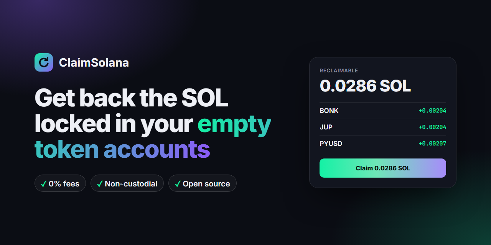
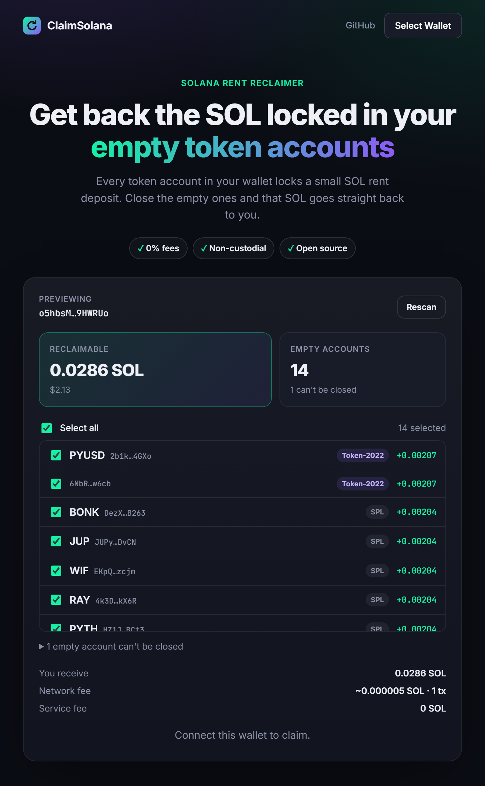

<p align="center">
  
</p>

<p align="center">
  <a href="LICENSE"></a>
  
  
  
  
</p>

# ClaimSolana

Every time a Solana wallet receives a new token, it opens a **token account** and locks a small rent deposit in it. When the balance of that token drops to zero, the account stays open and the SOL stays locked.

ClaimSolana finds those empty accounts, closes them, and sends the rent straight back to your wallet. **No service fee, no custody, no hidden instructions.**

<p align="center">
  
  <br>
  <sub>Example scan of a demo wallet</sub>
</p>

## Features

- **Scans SPL Token and Token-2022** accounts and lists only those with a balance of exactly zero.
- **Pick what to close.** Every account is listed with its token, program, and the SOL it returns.
- **Transparent costs.** Shows what you receive, the network fee and the service fee (always 0) before you sign.
- **Read-only preview.** Paste any address, or share `/?address=<wallet>`, to see what it could reclaim without connecting.
- **Skips what can't be closed:** frozen accounts, accounts with a third-party close authority, and Token-2022 accounts with withheld transfer fees.
- **Batched and confirmed.** Up to 20 accounts per transaction, signed in one approval, with links to every transaction on Solscan.
- **Your RPC key stays private.** The browser talks to a small `/api/rpc` proxy that only forwards the five methods the app uses.

## What gets signed

Every transaction only contains `CloseAccount` instructions from the SPL Token or Token-2022 program, with **your own wallet as the destination**. Nothing else. You can check it in [`src/lib/reclaim.ts`](src/lib/reclaim.ts) and in your wallet's transaction preview before approving.

## Getting started

Requirements: Node.js 20+ and a Solana RPC endpoint. Public endpoints block the calls this app needs; a free plan from [Helius](https://www.helius.dev), [QuickNode](https://www.quicknode.com) or [Triton](https://triton.one) is enough.

```bash
git clone https://github.com/luden-sudo/ClaimSolana.git
cd ClaimSolana
npm install
cp .env.example .env.local   # then set SOLANA_RPC_URL
npm run dev
```

Open [http://localhost:3000](http://localhost:3000).

| Variable | Where it's used | Description |
| --- | --- | --- |
| `SOLANA_RPC_URL` | Server only (`/api/rpc`) | Mainnet RPC URL, including your provider key |

### Deploy

[](https://vercel.com/new/clone?repository-url=https%3A%2F%2Fgithub.com%2Fluden-sudo%2FClaimSolana&env=SOLANA_RPC_URL&envDescription=Solana%20mainnet%20RPC%20URL%20with%20your%20provider%20key)

## Project structure

```
src/
├── components/Sections.tsx   Logo, "How it works" and FAQ
├── lib/
│   ├── reclaim.ts            Scan, build and confirm close-account transactions
│   ├── format.ts             SOL/USD formatting, known token labels
│   └── config.ts             RPC endpoint and repo URL
├── pages/
│   ├── api/rpc.ts            JSON-RPC proxy with a method allowlist
│   ├── _app.tsx              Wallet providers (Wallet Standard)
│   └── index.tsx             The app
└── styles/globals.css
```

## Scripts

| Command | Description |
| --- | --- |
| `npm run dev` | Start the dev server |
| `npm run build` | Production build |
| `npm run start` | Serve the production build |
| `npm run lint` | ESLint |
| `npm run typecheck` | TypeScript check |

## FAQ

**Will I lose tokens or NFTs?** No. Accounts holding any balance are never listed.

**Can I receive that token again?** Yes. A new account is opened automatically the next time you receive it (and the rent is paid again).

**Why is the amount per account different between tokens?** Rent depends on the account size. Token-2022 accounts with extensions are slightly bigger.

## License

[MIT](LICENSE). Not affiliated with the Solana Foundation. Use at your own risk.
